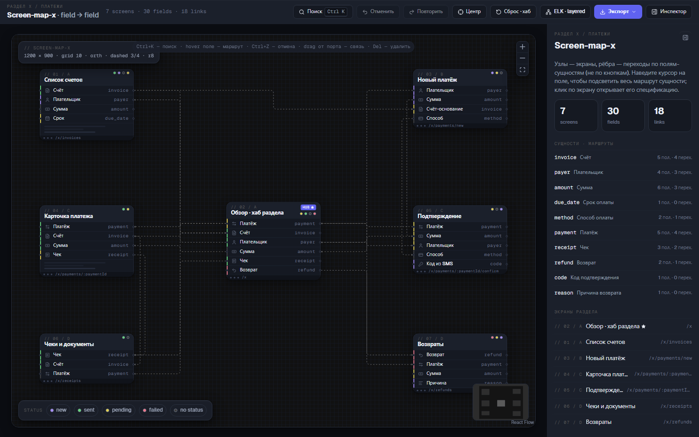

# Screen-map-x

[](https://github.com/stsgs1980/screen-map-x/actions/workflows/ci.yml)
[](LICENSE)
[](.nvmrc)
[](https://www.typescript.org/)
[](https://react.dev/)

> **Status**: ACTIVE
> **Version**: 2.0.0
> **Last Updated**: 2026-10-21



## Overview

Интерактивная карта экранов раздела X: узлы - это экраны, а ребра - переходы по
полям-сущностям, а не по кнопкам. Связи привязаны `field -> field`, поэтому при
перестановке карточек ортогональные линии следуют за конкретными строками полей.

Карта одновременно является спецификацией и редактором схемы: экраны можно
перетаскивать по сетке 10 px, новые связи тянутся от портов полей, ELK строит
автоматическую layered-раскладку сверху вниз, а актуальное состояние экспортируется
в JSON.

## Table of Contents

- [Features](#features)
- [Specification](#specification)
- [Tech Stack](#tech-stack)
- [Getting Started](#getting-started)
- [Scripts](#scripts)
- [Docs](#docs)
- [Architecture](#architecture)
- [Data Model](#data-model)
- [Testing](#testing)
- [Contributing](#contributing)
- [Conventions](#conventions)
- [License](#license)

## Features

- Семь экранов раздела, центральный хаб и 18 исходных переходов поле -> поле.
- Подсветка полного маршрута сущности при наведении на поле, линию или сущность.
- Закрепление маршрута кликом, фильтр полей по статусу и спецификация экрана.
- Ручное редактирование графа: drag карточек, drag от порта, Delete, undo/redo.
  Связь между полями разных сущностей не создаётся - приложение сообщает об этом тостом,
  потому что ребро всегда описывает передачу одной сущности.
- Автораскладка ELK `layered / DOWN / ORTHOGONAL` с анимированным переходом и снапом на сетку 10 px.
- Командная палитра Ctrl+K: экраны, поля, сущности и действия карты.
- Скрываемая правая панель инспектора и автоцентровка холста при загрузке, resize и переключении панели.
- Контекстные меню экранов и связей, preview-карточки сущностей и tooltip полей.
- Просмотр, копирование и скачивание JSON-схемы, уведомления Toast.
- Полный набор гейтов: ESLint, Stylelint, markdownlint, Prettier, TypeScript,
  Vitest, Playwright, проверка длины файлов и согласованности документации.

## Specification

| Требование                        | Реализация                                                                  |
| --------------------------------- | --------------------------------------------------------------------------- |
| Холст 1200 x 900, фон `#111`      | Фиксированный frame и React Flow Background Lines                           |
| Сетка и snap 10 px                | `snapGrid: [10, 10]`, позиции экранов в модулях данных и снап ELK-раскладки |
| Заголовок карточки 40 px          | `HEAD_H = 40` в `src/features/screen-map/data/constants.ts`                 |
| Строка поля 23 px                 | `ROW_H = 23`, компонент `FieldRow`                                          |
| Скелетон 30 px и chrome 13 px     | Опциональный блок и нижняя полоса карточки                                  |
| Иконки полей 12 px, порты 5 px    | Lucide 12 px и отдельные React Flow Handle по краям                         |
| Линии orth, dash 3/4, `#7C7C7C`   | SmoothStep с радиусом 8 px в `OrthEdge`                                     |
| 7 экранов, хаб в центре           | Хаб `// 02 / A` и шесть сателлитов                                          |
| Статусы полей                     | `new`, `sent`, `pending`, `failed`, `no status`                             |
| Моно-подписи 10 px, spacing .11em | `.mono-label`, цвет `#5A5A5A`, шрифт Geist Mono                             |
| ELK layered / DOWN                | Лениво загружаемый `elkjs`, стороны портов по геометрии                     |
| Экспорт JSON                      | `buildExport()` и образец `artifacts/section-x-screen-map.schema.json`      |

### Взаимодействие

- **Hover поля, линии или сущности** - маршрут сущности загорается на всех экранах,
  остальные элементы затемняются, на линиях появляются чипы сущности.
- **Клик по сущности** - закрепить маршрут; клик по пустому холсту сбрасывает выбор и pin.
- **Клик по экрану** - открыть роут, API, состояния, поля и входящие/исходящие связи.
- **Правый клик** - контекстное меню экрана или связи.
- **Ctrl+K** - поиск и команды; **Ctrl+Z / Ctrl+Shift+Z / Ctrl+Y** - undo/redo.
- **Delete** - удалить выбранную связь. История zundo хранит только граф, а не hover,
  выбор экрана и промежуточные позиции во время drag.
- **Знак вопроса** - диалог со справкой по клавишам и жестам вне полей ввода.
- **Инспектор** - убрать или вернуть правую панель; верхняя панель при этом остается видимой,
  а выбор сохраняется в браузере.
- **Центр** - вписать всю карту в холст и выровнять рамку по центру доступной области.

## Tech Stack

- **Language**: TypeScript 6.0, strict mode.
- **UI**: React 19, Vite 8, Geist Sans и Geist Mono.
- **Graph**: `@xyflow/react` 12, `elkjs` 0.12.
- **State**: zustand 5 и zundo 2 для истории графа.
- **Primitives**: `@base-ui/react`, cmdk и lucide-react.
- **Tests**: Vitest 5 для чистой логики и store, Playwright для браузерных сценариев.
- **Quality**: ESLint 9, Stylelint 17, markdownlint, Prettier 3.
- **Process**: Husky, lint-staged, commitlint, Conventional Commits, GitHub Actions.

## Getting Started

### Prerequisites

- Node.js >= 22.22.2; для разработки зафиксирована версия 24.15.0 в `.nvmrc`.
- npm >= 10.9.0. В `.npmrc` включен `engine-strict=true`.
- Для e2e один раз установите браузер Playwright: `npx playwright install --only-shell chromium`.

### Installation

```bash
git clone <repository-url>
cd screen-map-x
nvm use
npm install
```

Скрипт `npm run prepare` активирует Husky. Если хуки после клонирования не
заработали, выполните его вручную из корня репозитория.

### Run

```bash
npm run dev
```

Приложение откроется на `http://localhost:5173`.

### Build and export

```bash
npm run build
npm run preview
npm run export:schema
```

`npm run export:schema` обновляет `artifacts/section-x-screen-map.schema.json` из исходных
данных. Экспорт из интерфейса дополнительно учитывает текущие позиции и ручные связи.

## Scripts

| Команда                     | Описание                                         |
| --------------------------- | ------------------------------------------------ |
| `npm run dev`               | Vite dev server на порту 5173                    |
| `npm run dev:lan`           | Тот же dev server, доступный из локальной сети   |
| `npm run build`             | TypeScript и production build                    |
| `npm run preview`           | Локальный preview production-сборки              |
| `npm run preview:lan`       | Preview, доступный из локальной сети             |
| `npm run lint`              | ESLint по JS, TS, TSX и Markdown-сниппетам       |
| `npm run lint:css`          | Stylelint по CSS                                 |
| `npm run lint:md`           | markdownlint по документации                     |
| `npm run typecheck`         | `tsc --noEmit`                                   |
| `npm run format`            | Prettier с записью изменений                     |
| `npm run format:check`      | Prettier без записи, режим CI                    |
| `npm test`                  | Unit-тесты Vitest                                |
| `npm run test:watch`        | Vitest в watch-режиме                            |
| `npm run test:coverage`     | Vitest с coverage                                |
| `npm run test:e2e`          | Playwright-сценарии в Chromium                   |
| `npm run check:file-length` | Anti-monolith: максимум 250 строк в TS/JS-файле  |
| `npm run check:docs`        | Сверка README и `docs/` с пакетами и путями      |
| `npm run changelog`         | Генерация `CHANGELOG.md` из Conventional Commits |
| `npm run export:schema`     | Генерация образца JSON-схемы                     |
| `npm run prepare`           | Установка Git-хуков Husky                        |

## Docs

| Документ                                      | Содержание                                 |
| --------------------------------------------- | ------------------------------------------ |
| [getting-started.md](docs/getting-started.md) | Установка, запуск, гейты и troubleshooting |
| [kickoff.md](docs/kickoff.md)                 | Как заменить демо-данные реальным разделом |
| [webstorm.md](docs/webstorm.md)               | Настройки WebStorm и включённые `.idea/`   |
| [testing.md](docs/testing.md)                 | Unit, e2e и визуальная проверка            |
| [markdown.md](docs/markdown.md)               | Правила оформления Markdown                |
| [SECURITY.md](SECURITY.md)                    | Политика безопасности и состояние аудита   |

## Architecture

```text
src/
  app/                         точка входа и тонкая оболочка приложения
  features/screen-map/
    data/                      типы, экраны, сущности, ребра и экспорт
    flow/                      адаптер семантического графа к React Flow
    layout/                    ELK adapter и анимация позиций
    model/                     graph/UI slices, history bridge и flow instance
    hooks/                     экспорт JSON и глобальные горячие клавиши
    ui/                        карточки, ребра, меню, диалоги и инспектор
    styles/                    CSS карты и UI-примитивов
  shared/                      lucide icons и ambient TypeScript declarations
tests/e2e/                     Playwright-сценарии
scripts/                       запускаемые npm-скрипты: проверки, changelog, экспорт, кадры
tools/eslint/                  подключаемый ESLint-плагин: правило, процессор, парсер
docs/assets/screenshots/       кадры текущего интерфейса для ручной сверки
docs/design/                   спецификация дизайн-системы и план её внедрения
artifacts/                     образец экспортной JSON-схемы
```

Где что лежит:

- **Юнит-тесты** — рядом с кодом, который они проверяют: `src/**`, `scripts/**`,
  `vite.config.test.ts` в корне. `vitest.config.ts` подбирает их по этим путям.
- **E2E-тесты** — в `tests/e2e/`, их запускает Playwright; vitest их не собирает.
- **`scripts/`** — то, что запускается через npm-скрипты из `package.json`
  (проверки, changelog, экспорт схемы, снимки экрана).
- **`tools/eslint/`** — то, что подключается к ESLint из `eslint.config.js`
  (кастомное правило, markdown-процессор, парсер). Это код плагина, а не скрипт.

Главные инварианты:

- Данные экранов и ребер не зависят от React Flow; адаптер находится в `src/features/screen-map/flow/adapter.ts`.
- Graph slice владеет `nodes`, `edges`, раскладками и командами истории; UI slice владеет
  выбором, hover, фильтрами, диалогами и контекстным меню.
- История undo/redo содержит только `nodes` и `edges`.
- Во время анимации раскладки история ставится на паузу; финальная позиция дает один шаг undo.
- Иконки Lucide импортируются по одному модулю, чтобы production-бандлер не обрабатывал
  весь корневой граф пакета.

## Data Model

Чтобы построить карту другого раздела, отредактируйте модули в `src/features/screen-map/data/`:

1. `SCREENS` в `src/features/screen-map/data/screens.ts`: id, код, заголовок, route, API, состояния,
   поля, начальная позиция и признак хаба.
2. `ENTITY_META` в `src/features/screen-map/data/entities.ts`: подпись и иконка сущности.
3. `EDGE_DEFS` в `src/features/screen-map/data/edges.ts`: переходы `{ screen, entity } -> { screen, entity }`.
4. При необходимости статусы в `src/features/screen-map/data/status.ts` и геометрию в `src/features/screen-map/data/constants.ts`.
5. Типы домена лежат в `src/features/screen-map/data/types.ts`, контракт id полей и портов -
   в `src/features/screen-map/data/fields.ts`: идентификатор порта собирается как
   `<screen>.<entity>|<L|R>|<in|out>`, и именно его используют порты и связи.

После изменений выполните `npm test`, `npm run export:schema` и `npm run test:e2e`.
Тесты данных проверяют уникальность и связность идентификаторов, а экспорт строится из
тех же определений, что и интерфейс.

## Testing

- Unit: 37 тестов в 9 файлах: `src/features/screen-map/flow/adapter.test.ts`,
  `src/features/screen-map/data/data.test.ts`, `src/features/screen-map/data/export.test.ts`,
  `src/features/screen-map/layout/elk.test.ts`, `src/features/screen-map/model/mapStore.test.ts`,
  `src/features/screen-map/model/layoutHistory.test.ts`, `src/features/screen-map/model/elkRun.test.ts`,
  `scripts/docs-checks.test.ts` и `vite.config.test.ts`.
- E2E: 7 сценариев в `tests/e2e/screen-map.spec.ts`: рендер, hover-маршрут и tooltip,
  палитра, экспорт в буфер, фильтр статусов, контекстное удаление связи и undo,
  скрытие/восстановление правого инспектора с проверкой центровки холста.
- Visual: кадры в `docs/assets/screenshots/` используются для ручной сверки,
  а не как pixel-snapshot assertions. Их переснимает `npm run screenshots`.

Подробности: [docs/testing.md](docs/testing.md).

## Contributing

1. Создайте ветку от `main`, например `feat/short-name`.
2. Вносите изменения небольшими логическими коммитами в Conventional Commits.
3. Перед коммитом Husky запустит lint-staged и проверку длины файлов.
4. Перед push Husky выполнит `npm run typecheck` и `npm test`.
5. Для релизной ветки обновите журнал командой `npm run changelog` и закоммитьте
   `CHANGELOG.md` отдельным docs-коммитом.
6. CI должен пройти форматирование, все линтеры, типы, unit, build и e2e.

## Conventions

- TypeScript strict, явные типы параметров и возвращаемых значений, JSDoc для public API.
- Отступ 2 пробела, двойные кавычки, semicolons, trailing commas, ширина 120.
- Файл TS/JS - до 250 строк (`npm run check:file-length` и ESLint `max-lines`).
- Функция - до 50 строк кода (ESLint `max-lines-per-function`).
- React-компонент - до 200 строк кода: компоненты в `src/features/screen-map/ui/` и
  `ScreenMapPage` проверяются отдельным лимитом ESLint, остальные функции - общим.
- Не собирайте динамические классы фрагментами с начальным пробелом вида `" on"`:
  `prettier-plugin-tailwindcss` может обрезать такой пробел и склеить классы.
  Используйте полные строки (`"fld on"`) или массив с `.join(" ")`.
- Markdown: ASCII `->` и `...`, fences с языком, выровненные таблицы; см.
  [docs/markdown.md](docs/markdown.md).
- Комментарии и identifiers - на английском; пользовательские тексты и документация -
  на русском.

## License

MIT. См. [LICENSE](LICENSE).
